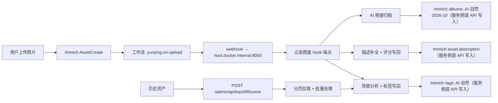

# AI 图像语义搜索微服务

基于 FastAPI 的 AI 图像语义搜索微服务，对接 [Immich](https://immich.app/) 开源照片管理平台与华为云 FRS 人脸识别服务，提供语义搜索、复合条件搜索、人脸分类、AI 图像分析四大核心能力。

## 功能特性

### 核心算法（7 项）

| # | 功能 | 公式 / 说明 |
|---|------|-------------|
| 1 | **语义搜索** | 对接 Immich `POST /api/search/smart`，自然语言查图 |
| 2 | **指数时间衰减二次排序** | `Final = α·2^(-Age/HalfLife) + β·Similarity`，新照片加权更高 |
| 3 | **查询意图动态权重** | `α_dynamic = α_base + γ·IntentScore`，按查询语义自动调节时间/相似度权重 |
| 4 | **多模态向量加权融合** | `V_final = λ·V_text + (1-λ)·V_vision`，加权拼接模拟向量融合（λ=0.7） |
| 5 | **华为云 FRS 人脸分类** | SDK-HMAC-SHA256 签名 + 高斯核概率软聚类 + 并查集分组 |
| 6 | **华为云 Image Tagging** | AK/SK 签名调用 `/v1.0/image/tagging`，标签增强语义搜索 |
| 7 | **时间衰减 LFU 缓存** | `Heat = Freq·2^(-Age/HalfLife)`，替代 LRU，热门不淘汰 |

### 复合条件搜索（贝叶斯降级检索）

- 按 `person_id + location + query` 复合搜索，严格交集优先
- 交集为空时自动降级为加权评分合并：`Score = w1·S_person + w2·S_location + w3·S_query`
- 权重：person(0.5) > location(0.3) > query(0.2)

### Immich 原生集成

- **能力探测**：自动探测 Immich 版本与 9 项能力（搜索/元数据/标签/相册/人脸/插件/工作流…），依据能力降级
- **AI 场景标签写回**：搜索时异步将 AI 场景标签写回 Immich（幂等 + 可撤销 + 审计日志）
- **AI 描述/评分写回**：自动生成 AI 描述（场景+视觉属性）和评分（final_score→1-5星）写回 Immich
- **AI 相册写回**：按场景 + 月份自动创建/更新 Immich 相册（`AI·场景·YYYY-MM` 命名）
- **图片代理**：缩略图 / 原图 / 共享链接代理，避免前端直连 Immich
- **增量水位同步**：基于 `updatedAt` 水线增量拉取，避免全量扫描
- **bulk-upload-check**：上传前查重，避免重复入库
- **写回管理**：统一写回客户端（`idempotent` / `rollback` / `audit` 三模式），一键回滚
- **冲突策略**：标签/相册冲突时可配置策略（skip / overwrite / merge），失败不阻塞主流程

### Immich 工作流集成（事件原生触发 + 服务侧写回）

- **机制（实测 immich-plugin-core v2.0.1 源码确认）**：工作流 `webhook` 方法
  实现为 `httpRequest(...); return {}`，**Immich 不应用回调响应中的 changes**。
  因此本服务的写回链路为：Immich 工作流事件**原生触发**（webhook 通知）→
  本服务分析 → 本服务通过 **Immich 公开 API**（`/api/tags` / `/api/albums` /
  `PUT /api/assets/{id}`）主动写回。回调响应的 `changes` 字段仅为诊断输出。
- **为何不用 `assetAddTags` / `assetAddToAlbums` 原生方法**：二者为工作流内
  静态配置（标签/相册 ID 写死在 workflow config），无法承载 CLIP 按图动态分析。
- **插件 hook 端点**：`POST /api/v1/plugin/hook`，接收 Immich 工作流 webhook 回调，触发场景分析 + 标签/相册写回
- **工作流管理**：通过 Immich v3.3+ 工作流 API 自动创建/更新/删除工作流
- **三个默认工作流**：
  - `yunying-on-upload`：`AssetCreate` → webhook → 场景分析 + 标签写回
  - `yunying-on-metadata`：`AssetMetadataExtraction` → webhook → 元数据补全
  - `yunying-on-tagged`：`AssetTagged` → webhook → 归档检查 + 相册写回

### 工程化能力

- 统一错误码体系（`AppError`，区分 400/401/429/502/503/504/500）
- API Key 鉴权（`hmac.compare_digest` 防时序攻击）
- 令牌桶限流（Redis / 内存降级，QPS + 突发容量）
- 优雅降级（`degraded: true` + 缓存兜底，上游不可用不报 5xx）
- 可插拔 AI 架构（抽象基类 + 依赖注入，切换引擎无需改业务代码）
- SSRF 防护（拒绝内网/回环/链路本地地址）
- 错误响应脱敏（自动遮蔽密码/密钥/连接串）
- 场景词典与标注（10 大场景 + 子场景 + 视觉属性白名单）
- AI 图像分析（同一人 / 相似图 / 无关 三分类判定）
- 搜索建议与纠错（热门词 LRU + Levenshtein 编辑距离）
- 搜索结果去重（连拍/相似图检测，时间窗口 + 尺寸 + 相似度）
- 搜索结果可解释性（每条结果附带排序原因）
- 搜索反馈闭环（点击/跳过信号 → 排序微调）
- 否定语义搜索（不要/没有/不含/排除 前缀解析）
- 时间语义化（自然语言时间表达 → 日期范围过滤）
- 以图搜图（参考图相似度搜索 + 候选合并）
- 自动相册（场景 + 时间聚类，时间切分）
- 统计大屏（GPS 地图分布 + EXIF + 器材统计）
- 批量导入（本地文件 → EXIF 提取 → 上传 Immich）
- 水印管理（文字/图片水印，批量处理，模板化）
- Redis 缓存后端（可选，不可用时自动降级到内存）
- 运行时配置热更新（管理接口动态切换功能开关）

### ML 服务层

- **ML 场景推理**：可插拔多后端（本地词典 / HTTP 远程 CLIP），批量推理 + 健康检查
- **向量索引**：内存余弦相似度向量索引，LRU 淘汰，支持以图搜图和语义检索
- **模型管理**：ML 模型生命周期管理（注册/加载/卸载/引用计数/超时保护/健康检查）

## API 接口

| 方法 | 路径 | 说明 |
|------|------|------|
| POST | `/api/v1/search/smart` | AI 语义搜索（视觉增强 + 二次排序 + 去重 + 可解释性） |
| POST | `/api/v1/search/multi-condition` | 复合条件搜索（贝叶斯降级检索） |
| POST | `/api/v1/search/feedback` | 搜索反馈闭环（点击/跳过信号采集） |
| GET | `/api/v1/search/suggest` | 搜索建议（热门词 + 前缀匹配） |
| GET | `/api/v1/search/correct` | 搜索纠错（Levenshtein 编辑距离） |
| GET | `/api/v1/search/albums` | 自动相册（场景 + 时间聚类） |
| POST | `/api/v1/faces/classify` | 人脸分类（检测 → 入库 → 搜索 → 聚类 → 分组） |
| POST | `/api/v1/ai/analyze` | AI 分析（同一人 / 相似图 / 无关判定） |
| POST | `/api/v1/import/batch` | 批量导入（本地文件 → EXIF → 上传 Immich） |
| GET | `/api/v1/scene/dict` | 获取场景词典（只读） |
| GET | `/api/v1/stats/map` | 统计大屏 — 地图分布（GPS 热力） |
| GET | `/api/v1/stats/exif` | 统计大屏 — EXIF 分布（相机/镜头/焦距） |
| GET | `/api/v1/stats/gear` | 统计大屏 — 器材统计（品牌/机型排行） |
| GET | `/api/v1/watermark/templates` | 水印模板列表 |
| GET | `/api/v1/watermark/licenses` | 水印字体许可证 |
| POST | `/api/v1/watermark/apply` | 批量添加水印（文字/图片） |
| GET | `/api/v1/assets/{id}/thumbnail` | 图片代理 — 缩略图/预览图 |
| GET | `/api/v1/assets/{id}/original` | 图片代理 — 原图 |
| POST | `/api/v1/plugin/hook` | Immich 插件/工作流 webhook 回调 |
| GET | `/admin/api/features` | 管理接口 — 功能开关查询 |
| PUT | `/admin/api/features` | 管理接口 — 功能开关更新 |
| GET | `/admin/api/status` | 管理接口 — 服务状态 |
| GET | `/admin/api/settings` | 管理接口 — 配置查询 |
| PUT | `/admin/api/settings` | 管理接口 — 配置更新 |
| GET | `/admin/api/capabilities` | 管理接口 — Immich 能力探测 |
| POST | `/admin/api/sync` | 管理接口 — 增量水位同步 |
| GET | `/admin/api/writeback/audit` | 管理接口 — 写回审计日志 |
| GET | `/admin/api/workflows` | 管理接口 — 工作流列表 |
| POST | `/admin/api/workflows/setup` | 管理接口 — 创建默认工作流 |
| DELETE | `/admin/api/workflows/{id}` | 管理接口 — 删除工作流 |
| POST | `/admin/api/writeback/descriptions` | 管理接口 — 手动触发描述/评分写回 |
| GET | `/admin/api/ml/health` | 管理接口 — ML 服务健康检查 |
| GET | `/admin/api/ml/models` | 管理接口 — 模型列表 |
| POST | `/admin/api/ml/models/{name}/load` | 管理接口 — 加载模型 |
| POST | `/admin/api/ml/models/{name}/unload` | 管理接口 — 卸载模型 |
| GET | `/admin/api/vector/stats` | 管理接口 — 向量索引统计 |
| GET | `/health` | 健康检查 |

### 请求示例

```json
POST /api/v1/search/smart
{
  "query": "海边日落",
  "limit": 20
}
```

### 响应示例

```json
{
  "query": "海边日落",
  "total": 1,
  "degraded": false,
  "warnings": [],
  "translated_query": "a photo of the sunset at the beach",
  "cached": false,
  "dedup_removed": 1,
  "results": [
    {
      "asset_id": "74f0...",
      "thumbnail_url": "http://127.0.0.1:3200/api/assets/74f0.../thumbnail?size=preview",
      "original_url": "http://127.0.0.1:3200/api/assets/74f0.../original",
      "captured_at": "2025-11-09T09:05:31Z",
      "captured_at_source": "exif",
      "similarity_score": null,
      "immich_rank": 0,
      "time_freshness": 0.521,
      "final_score": null,
      "metadata": {"width": 6048, "height": 4024, "format": "image/arw"},
      "scene": {
        "primary_scene": "nature",
        "sub_scenes": ["ocean", "beach"],
        "confidence": {"ocean": 0.7419, "beach": 0.7224, "nature": 0.6732},
        "source": "analyzed"
      },
      "explanation": {"reasons": ["命中场景：自然"], "time_score": 0.5212}
    }
  ]
}
```

## 搜索链路与可信度说明

> 本节回答「搜索结果为什么可信、分数从哪里来」。上线前请通读，避免误读字段。

### 检索主链路（Immich 单一事实源）

```
中文查询 → 词表语义化（translated_query）→ Immich smart search（CLIP）
        → 4 级去重 → 按上游顺序返回（不二次排序）
```

1. **查询语义化**：`app/scene/query_translate.py` 维护 1000+ 词条（主体名词 / 修饰词 / 景别），
   最长优先贪心匹配，组合成**单条英文短语**（如 `海边日落` → `a photo of the sunset at the beach`），
   交给 Immich ML 的 CLIP 多语言检索。禁止逗号拼接泛化 prompt（会稀释语义导致结果与查询不相关）。
2. **检索与排序**：结果顺序即 Immich 返回顺序（`immich_rank` 从 0 开始），**服务端不做任何二次排序**。
3. **去重信号（4 级）**：`dedup_removed` 字段报告本次去重数量（asset_id / 内容指纹 / 上游位置 / 时间）。

### 分数字段语义（防误读）

| 字段 | 语义 | 何时为 null |
|------|------|------------|
| `similarity_score` | 上游相似度。Immich v3.3.1 smart search **不返回分数**，因此恒为 `null`，前端不应展示百分比 | 上游无分数时 |
| `immich_rank` | 上游排序位次（0 = 第一名）。前端应以此展示「排序来源：Immich 智能搜索」 | 永不为 null |
| `final_score` | 历史综合分。当前链路下为 `null`，仅多条件搜索等场景有值 | 未计算时 |
| `time_freshness` | 时间新鲜度（0-1），仅作解释展示，不参与排序 | 永不为 null |
| `scene.confidence` | CLIP 场景分类置信度（0.5-0.95，按 ViT-B-32 实测分布校准），仅描述场景标签可信度，**不是**与查询的相关度 | 无场景时 |

**原则**：服务端绝不伪造相似度分数。无法从上游拿到分数时宁可返回 `null`。

### 场景来源三态（scene.source）

| source | 含义 | 会写回 Immich 吗 |
|--------|------|-----------------|
| `analyzed` | CLIP 零样本真实推理结果（置信度 ≥ `SCENE_MIN_CONFIDENCE`） | ✅ 白名单放行 |
| `inferred` | 按查询词推断的场景（仅搜索展示用） | ❌ |
| `fallback` | 兜底默认场景（`life`） | ❌ 白名单拦截 |

只有 `analyzed` 且过置信度门槛的场景才会写回 Immich（防止兜底值污染图库）。
写回总开关为 `.env` 的 `WRITEBACK_ENABLED`（单一来源，无运行时覆盖），可在
`GET /admin/api/status` 的 `writeback` 块实时查看。

### 验收脚本（T9 交付）

```bash
# 搜索链路：20 条中文查询端到端（翻译/结果数/告警/分数来源）
python scripts/verify_search.py --base-url http://127.0.0.1:8000

# 工作流集成：健康/容器可达/工作流/hook鉴权/上传出标签/相册/审计/幂等/降级
python scripts/verify_native.py --immich-key <key> --output data/verify_native_report.json
```

2026-10-18 基线：搜索 20/20 PASS，工作流集成 13/13 PASS。


### 错误响应

```json
{
  "error": {
    "code": "UPSTREAM_UNAVAILABLE",
    "message": "Immich 服务不可用: POST /api/search/smart",
    "request_id": "9f3a...",
    "details": "ConnectError..."
  }
}
```

## 项目结构

```
a01/
├── app/
│   ├── main.py                          # FastAPI 入口（lifespan / 中间件 / 异常处理器）
│   ├── api/
│   │   ├── deps.py                      # 依赖注入（鉴权 / 服务获取）
│   │   └── routes/
│   │       ├── search.py                # 搜索路由（smart / multi-condition / suggest / correct / albums / feedback）
│   │       ├── faces.py                 # 人脸分类路由
│   │       ├── ai.py                    # AI 分析路由
│   │       ├── scene.py                 # 场景词典路由
│   │       ├── stats.py                 # 统计大屏路由（map / exif / gear）
│   │       ├── admin.py                 # 管理接口路由（功能开关 / 配置 / 状态 / 工作流）
│   │       ├── assets.py                # 资产代理路由（缩略图 / 原图 / 共享链接）
│   │       ├── plugin.py                # Immich 插件/工作流 hook 回调路由
│   │       ├── batch_import.py          # 批量导入路由
│   │       └── watermark.py            # 水印管理路由
│   ├── core/
│   │   ├── config.py                    # pydantic-settings 配置
│   │   ├── errors.py                    # 错误码与领域异常体系
│   │   ├── logging.py                   # 日志配置
│   │   ├── cache.py                     # 缓存抽象（内存 + Redis 降级）
│   │   ├── rate_limit.py                # 令牌桶限流（Redis / 内存降级）
│   │   ├── redis_client.py              # Redis 客户端封装
│   │   └── runtime_config.py            # 运行时配置（热更新）
│   ├── models/
│   │   ├── request.py                   # 请求模型
│   │   ├── response.py                  # 响应模型
│   │   ├── face.py                      # 人脸分类请求/响应模型
│   │   ├── ai.py                        # AI 分析请求模型
│   │   ├── batch_import.py              # 批量导入请求模型
│   │   ├── stats.py                     # 统计大屏响应模型
│   │   └── watermark.py                 # 水印请求/响应模型
│   ├── services/
│   │   ├── immich.py                    # Immich 客户端（重试/超时/错误分类）
│   │   ├── immich_uploader.py           # Immich 文件上传
│   │   ├── immich_capabilities.py       # Immich 能力探测（版本/搜索/插件/工作流…）
│   │   ├── immich_writeback.py          # 统一写回客户端（幂等/回滚/审计）
│   │   ├── writeback_manager.py         # 写回管理 + 冲突策略 + 一键回滚
│   │   ├── scene_writeback.py           # AI 场景标签写回
│   │   ├── album_writeback.py           # AI 相册写回（场景 + 月份）
│   │   ├── image_proxy.py               # 图片代理（缩略图/原图/共享链接）
│   │   ├── incremental_sync.py          # 增量水位同步（updatedAt 水线）
│   │   ├── workflow_manager.py          # Immich 工作流管理（创建/更新/删除/默认模板）
│   │   ├── description_writeback.py     # AI 描述/评分写回（场景→描述 + score→星级）
│   │   ├── ml_scene_inferrer.py         # ML 场景推理（本地词典/HTTP远程，批量推理）
│   │   ├── vector_index.py              # 向量索引（余弦相似度，LRU淘汰）
│   │   ├── model_manager.py             # 模型管理（注册/加载/卸载/引用计数/健康检查）
│   │   ├── ranking.py                   # 二次排序算法（衰减/动态权重/多模态融合/场景权重）
│   │   ├── search_service.py            # 搜索编排（视觉增强 + 场景标注 + 排序 + 去重）
│   │   ├── face_service.py              # 人脸分类编排（检测/入库/搜索/高斯聚类）
│   │   ├── multi_condition_service.py   # 复合条件搜索（严格交集 + 贝叶斯降级）
│   │   ├── album_service.py             # 自动相册（场景 + 时间聚类）
│   │   ├── suggest_service.py           # 搜索建议（热门词 + 前缀匹配）
│   │   ├── feedback_service.py          # 搜索反馈闭环
│   │   ├── image_query_service.py       # 以图搜图
│   │   ├── importer.py                  # 批量导入（EXIF 提取 + 上传）
│   │   ├── stats_provider.py            # 统计大屏数据层
│   │   ├── dedup.py                     # 搜索结果去重（连拍/相似图）
│   │   ├── explain.py                   # 搜索结果可解释性
│   │   ├── metadata.py                  # 元数据提取
│   │   ├── negation_parser.py           # 否定语义解析
│   │   ├── time_parser.py               # 时间语义解析
│   │   ├── watermark_engine.py          # 水印引擎
│   │   ├── watermark_processor.py       # 水印批处理
│   │   ├── watermark_templates.py       # 水印模板
│   │   └── vision/
│   │       ├── base.py                  # 视觉识别抽象基类 + 空实现
│   │       ├── huawei.py                # 华为云图像识别适配器（Image Tagging）
│   │       ├── huawei_face.py           # 华为云 FRS 人脸识别客户端
│   │       └── huawei_signer.py         # SDK-HMAC-SHA256 签名工具
│   ├── ai/
│   │   ├── base.py                      # AI 分析抽象基类 + 分类函数
│   │   ├── factory.py                   # 分析器工厂
│   │   ├── immich_analyzer.py           # 基于 Immich 的同人判定
│   │   └── huawei_analyzer.py           # 华为云人脸分析器
│   ├── scene/
│   │   ├── analyzer.py                  # 场景分析器（分级推理 + 缓存 + singleflight）
│   │   ├── dictionary.py                # 场景词典加载与白名单校验
│   │   ├── models.py                    # 场景标签数据模型
│   │   └── scene_dict.json              # 场景词典数据文件
│   └── utils/
│       ├── cache.py                     # 时间衰减 LFU 缓存
│       ├── date_parse.py                # 日期解析
│       ├── path_safety.py               # 路径安全校验
│       ├── time_parsing.py              # EXIF 时间解析与新鲜度计算
│       └── url_safety.py                # URL 安全校验（SSRF 防护）
├── tests/                               # 单元测试与集成测试（910+ 用例）
├── brute_test.py                        # 破坏性测试（160 用例，六大类场景）
├── verify_integration.py                # 端到端验收脚本（P1-P21，9 项检查）
├── .env.example                         # 环境配置示例
├── Dockerfile
├── docker-compose.yml
├── docker-compose.override.yml          # Immich 联合部署覆盖配置
├── nginx.conf                           # Nginx 反向代理配置
└── pyproject.toml
```

## 快速开始

```bash
# 1. 配置环境变量
cp .env.example .env
# 编辑 .env，填入 IMMICH_BASE_URL 与 IMMICH_API_KEY

# 2. 安装依赖
pip install -e ".[dev]"

# 3. 启动服务
uvicorn app.main:app --reload

# 4. 打开接口文档
# http://localhost:8000/docs
```

## 配置项

| 环境变量 | 默认值 | 说明 |
|----------|--------|------|
| `IMMICH_BASE_URL` | `http://localhost:2283` | Immich 服务地址 |
| `IMMICH_API_KEY` | — | Immich API Key |
| `SEARCH_API_KEY` | `""` | 搜索接口鉴权 Key（空=不鉴权） |
| `ADMIN_API_KEY` | `""` | 管理接口鉴权 Key（空=不鉴权） |
| `TIME_WEIGHT` | `0.3` | 时间权重 α |
| `SIMILARITY_WEIGHT` | `0.7` | 相似度权重 β |
| `QUERY_INTENT_GAMMA` | `0.4` | 查询意图动态权重强度 γ |
| `MULTIMODAL_LAMBDA` | `0.7` | 多模态融合权重 λ |
| `TIME_DECAY_HALF_LIFE_DAYS` | `365` | 时间衰减半衰期（天） |
| `SCENE_ENABLED` | `true` | 是否启用场景分析 |
| `SCENE_INFERENCE_ENDPOINT` | `""` | 场景推理服务端点（空=本地词典推理） |
| `SCENE_CACHE_HALFLIFE_DAYS` | `7` | 场景缓存半衰期（天） |
| `HUAWEI_ENABLED` | `false` | 是否启用华为云视觉识别 |
| `HUAWEI_FACE_ENABLED` | `false` | 是否启用人脸分类 |
| `HUAWEI_AK` / `HUAWEI_SK` | — | 华为云 AK/SK |
| `HUAWEI_PROJECT_ID` | — | 华为云项目 ID |
| `HUAWEI_IMAGE_ENDPOINT` | `https://image.cn-north-4.myhuaweicloud.com` | 华为云 Image 服务端点 |
| `HUAWEI_FRS_ENDPOINT` | `https://face.cn-north-4.myhuaweicloud.com` | 华为云 FRS 服务端点 |
| `FACE_GAUSSIAN_SIGMA` | `0.1` | 高斯聚类 σ |
| `FACE_PROBABILITY_THRESHOLD` | `0.85` | 聚类概率阈值 |
| `RATE_LIMIT_ENABLED` | `true` | 是否启用限流 |
| `RATE_LIMIT_QPS` | `50` | 限流 QPS |
| `RATE_LIMIT_BURST` | `100` | 限流突发容量 |
| `REDIS_ENABLED` | `false` | 是否启用 Redis 缓存后端 |
| `SUGGEST_ENABLED` | `true` | 是否启用搜索建议/纠错 |
| `EXPLAIN_ENABLED` | `true` | 是否启用搜索结果可解释性 |
| `DEDUP_ENABLED` | `true` | 是否启用搜索结果去重 |
| `IMAGE_QUERY_ENABLED` | `true` | 是否启用以图搜图 |
| `ALBUM_ENABLED` | `true` | 是否启用自动相册 |
| `NEGATION_ENABLED` | `true` | 是否启用否定语义搜索 |
| `STATS_ENABLED` | `true` | 是否启用统计大屏 |
| `WATERMARK_ENABLED` | `true` | 是否启用水印功能 |
| `FEEDBACK_ENABLED` | `true` | 是否启用搜索反馈 |
| `WRITEBACK_ENABLED` | `false` | 是否启用 AI 标签/相册写回 Immich |
| `WRITEBACK_MODE` | `idempotent` | 写回模式（`idempotent` / `rollback` / `audit`） |
| `PLUGIN_HOOK_TOKEN` | `""` | 插件 hook 端点鉴权 token（空=不鉴权） |

## 错误码体系

| 错误码 | HTTP | 触发场景 |
|--------|------|----------|
| `INVALID_PARAMS` | 400 | 参数校验失败 |
| `UNAUTHORIZED` | 401 | API Key 缺失或不正确 |
| `UPSTREAM_UNAVAILABLE` | 502 | Immich 连接失败 / 5xx |
| `UPSTREAM_TIMEOUT` | 504 | Immich 超时 |
| `UPSTREAM_ERROR` | 502 | Immich 4xx（鉴权/协议错误） |
| `VISION_UNAVAILABLE` | 502 | 华为云 FRS 不可用 |
| `VISION_TIMEOUT` | 504 | 华为云 FRS 超时 |
| `VISION_ERROR` | 502 | 华为云 FRS 4xx |
| `AI_ANALYZER_UNAVAILABLE` | 502 | AI 分析器上游不可用 |
| `AI_ANALYZER_TIMEOUT` | 504 | AI 分析器超时 |
| `SERVICE_UNAVAILABLE` | 503 | 功能未启用 |
| `RATE_LIMITED` | 429 | 请求触发限流 |
| `INTERNAL_ERROR` | 500 | 未捕获的内部异常 |

## 测试

```bash
# 单元测试 + 集成测试
pytest                    # 910+ passed

# 破坏性测试（六大类：输入畸形/网络故障/并发耗尽/数学边界/数据污染/安全攻击）
pytest brute_test.py      # 160 passed

# 端到端验收（需启动服务 + Immich）
python verify_integration.py --base-url http://127.0.0.1:8000
```

### 测试覆盖

- 请求模型校验、时间解析、排序算法、缓存淘汰
- Immich 客户端重试/超时/错误分类、搜索编排降级
- 人脸分类全流程（检测/入库/搜索/高斯聚类/分组）
- 复合条件搜索（严格交集/贝叶斯降级/加权评分）
- 多模态融合、查询意图动态权重、场景分析
- API 集成（鉴权/错误状态码/统一错误结构）
- 破坏性测试（SSRF/注入/并发/资源耗尽/数学边界）

## 部署

### Docker

```bash
docker compose up --build
```

`Dockerfile` 使用非 root 用户运行，`docker-compose.yml` 提供健康检查与自动重启。

### 日志与监控

- 结构化日志，每条响应携带 `x-request-id` 便于关联追踪
- `/health` 存活探针
- 可接入 Loki/ELK 集中式日志与 Prometheus 指标

## 关键设计决策

1. **指数衰减而非线性归一化**：`freshness = 2^(-age/half_life)` 单调、有界、对极老照片友好，不受单次结果集分布影响。拍摄时间来源优先级：EXIF > 文件创建时间 > 默认值，带溯源标记。

2. **高斯核概率软聚类**：`P(same_person) = exp(-((1-Sim)²)/(2σ²))`，替代硬阈值。相似度 0.61 与 0.63 不再被判定为完全不同的人，概率平滑过渡。σ=0.1，概率阈值=0.85。

3. **时间衰减 LFU 缓存**：`Heat = Freq·2^(-Age/HalfLife)`，同时考虑访问频次和时间衰减。热门照片因高 Freq 保持高 Heat，冷门搜索因低 Freq 自然淘汰，解决 LRU "冷门挤掉热门"的问题。

4. **多模态加权拼接**：Immich API 仅支持文本，通过重复 query N 次模拟向量级权重（`text_repeat = round(λ/(1-λ))`）。λ=0.7 → query 重复 2 次，vision_tags 1 次，近似 0.67:0.33 的权重比。

5. **贝叶斯降级检索**：严格交集为空时不简单去掉某个条件，而是分别独立搜索后加权合并。某条件完全无命中时，其他条件的部分命中仍能贡献评分，避免"全有或全无"的脆弱性。

6. **可插拔架构**：视觉识别、AI 分析器、场景推理器均为抽象基类 + 依赖注入，新增厂商实现只需新增适配器并在 `lifespan` 中装配，业务逻辑零改动。

## 团队协作

- GitCode 保护分支 + Pull Request 审查流程
- 全程使用华为云 CodeArts 辅助开发
- 已合并 20+ PR，910+ 单元测试 + 160 破坏性测试全部通过

## Immich 原生工作流部署

```bash
# 1. 启动服务
uvicorn app.main:app --host 127.0.0.1 --port 8000

# 2. 创建默认工作流（在 Immich 中自动注册三个工作流）
curl -X POST http://127.0.0.1:8000/admin/api/workflows/setup \
  -H "Content-Type: application/json" \
  -d '{"hook_url": "http://127.0.0.1:8000/api/v1/plugin/hook"}'

# 3. 验收
python verify_integration.py
```

三个工作流将在 Immich 中自动生效：
- 照片上传 → 自动场景分析 + AI 标签写回
- 元数据提取完成 → 自动补全描述
- 标签写入完成 → 自动归档检查 + AI 相册创建
## 工作流集成 Immich（事件触发 + 服务侧写回）

### 架构图



> 注：webhook 方法为 fire-and-forget（实测其源码 `return {}`），
> 写回不经过回调响应的 changes，全部由本服务主动调用 Immich 公开 API 完成。

### 四条工作流说明

| 工作流 | 触发器 | 作用 |
|--------|--------|------|
| yunying-on-upload | AssetCreate | 新资产上传后回调场景分析 + 标签写回 |
| yunying-on-metadata | AssetMetadataExtraction | EXIF 提取完成后补全场景描述 |
| yunying-on-tagged | AssetTagged | 标签添加完成后检查 AI 相册归档 |

### 回调地址为何必须是 host.docker.internal

Immich 运行在 Docker 容器中，容器内 `127.0.0.1` 指向容器自身而非宿主。
工作流 webhook 从容器内发起，如果回调地址写 `http://127.0.0.1:8000`，
请求会发到容器内的 8000 端口（不存在），导致回调失败。

`host.docker.internal` 是 Docker Desktop 提供的宿主别名，
容器内通过此地址可以访问宿主上的服务。

配置方式：
```bash
# .env
PLUGIN_CALLBACK_BASE_URL=http://host.docker.internal:8000
```

留空时自动探测：检测到 Immich 在容器中运行则使用 `host.docker.internal`。

### 开关清单

| 配置项 | 默认值 | 说明 |
|--------|--------|------|
| WRITEBACK_ENABLED | false | 写回总开关（标签/相册/描述） |
| PLUGIN_HOOK_TOKEN | (空) | hook 鉴权 token，非空时强制校验 |
| PLUGIN_CALLBACK_BASE_URL | (空) | 回调基地址，空=自动探测 |
| IMMICH_WORKFLOW_SYNC_ENABLED | true | 启动时自动同步工作流 |
| IMMICH_WORKFLOW_LOGGING | true | 工作流日志开关 |
| BACKFILL_CONCURRENCY | 5 | 回填任务并发度 |
| BACKFILL_PAGE_SIZE | 1000 | 回填每页资产数 |

### 验收命令

```bash
# 一键验收
python scripts/verify_native.py \
  --base-url http://127.0.0.1:8000 \
  --immich-url http://127.0.0.1:3200 \
  --immich-key <your-key> \
  --output report.json

# 同步工作流（幂等 upsert）
curl -X POST http://127.0.0.1:8000/admin/api/immich/workflows/sync

# 历史资产回填
curl -X POST http://127.0.0.1:8000/admin/api/backfill/scene \
  -H "Content-Type: application/json" \
  -d '{"limit": 100, "skip_tagged": true}'

# 查询回填进度
curl http://127.0.0.1:8000/admin/api/backfill/status
```

### 常见故障

| 故障 | 原因 | 解决 |
|------|------|------|
| 回调不可达 | url 用了 127.0.0.1 而非 host.docker.internal | 设置 PLUGIN_CALLBACK_BASE_URL |
| 无 AI 标签 | WRITEBACK_ENABLED=false | 管理页面开启写回开关 |
| 无工作流日志 | logging=false | 执行工作流同步：POST /admin/api/immich/workflows/sync |
| 写回未生效 | runtime_config.json 覆盖了 .env | 检查 data/runtime_config.json |
| 历史图无标签 | 3 万张历史图未触发工作流 | 执行回填：POST /admin/api/backfill/scene |

### 安全提示

> 曾用于调试的 Immich API Key 需在 Immich 后台吊销轮换。
> 所有密钥/Token 通过环境变量 + pydantic SecretStr 管理，不写入代码文件。